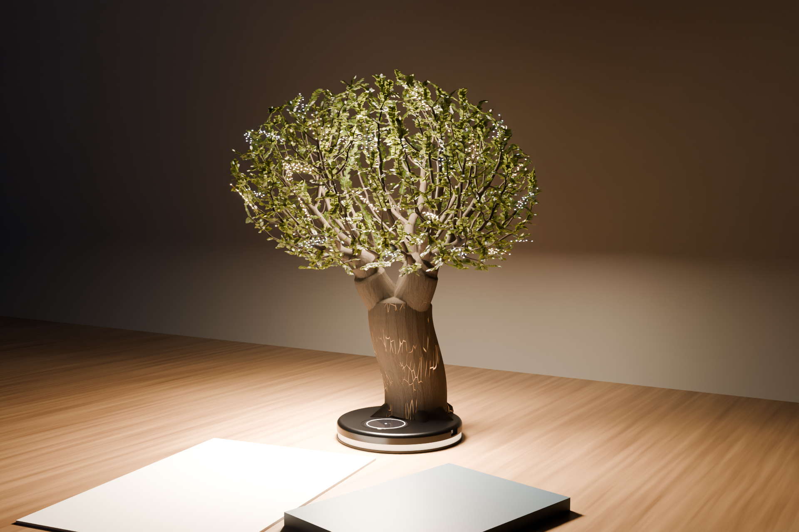
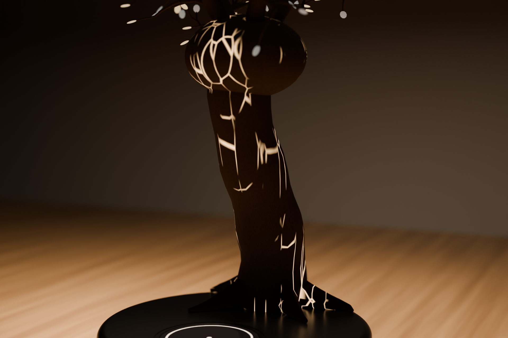
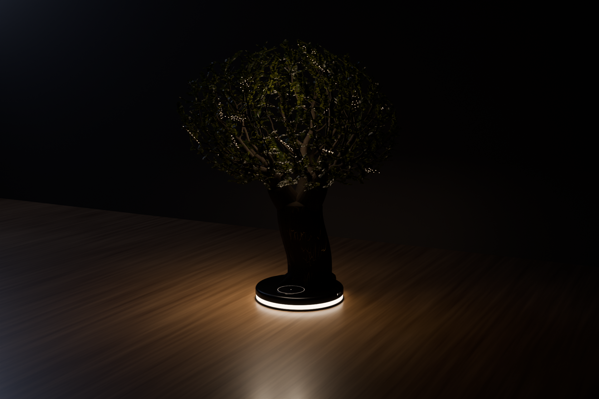
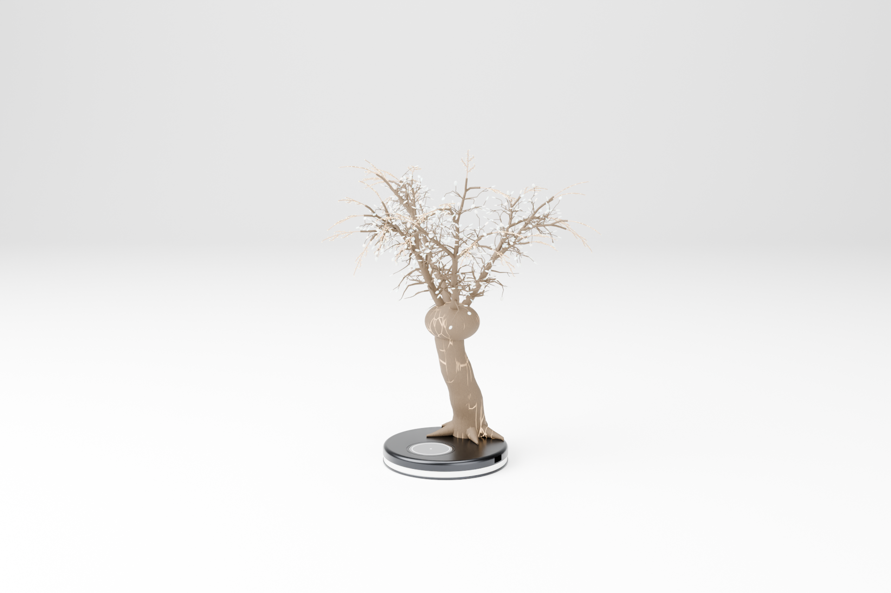
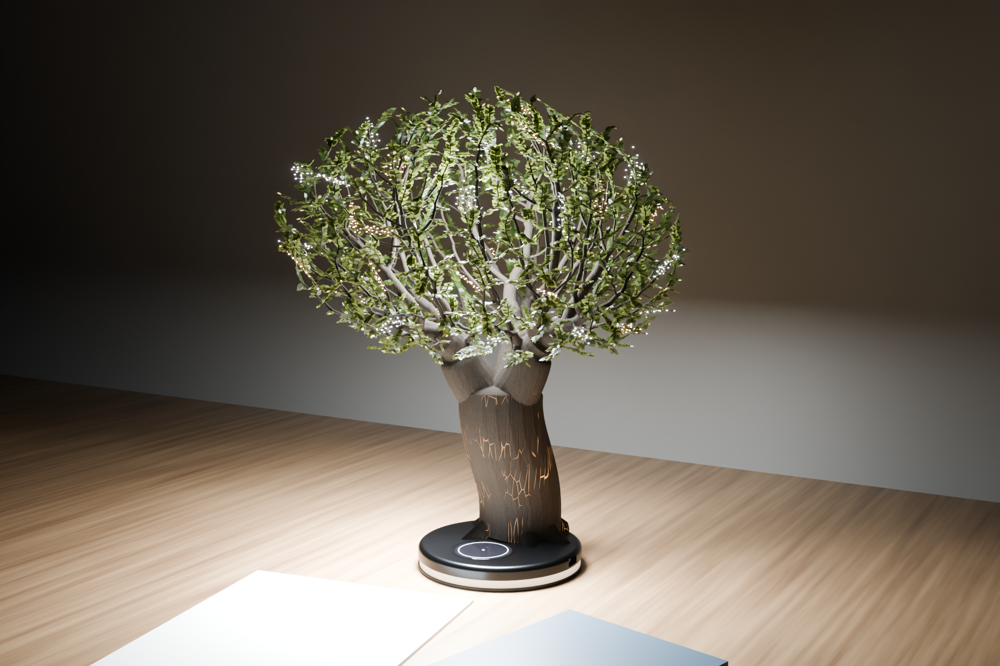
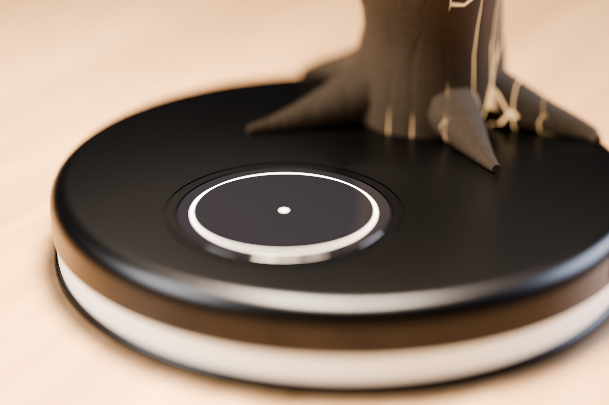
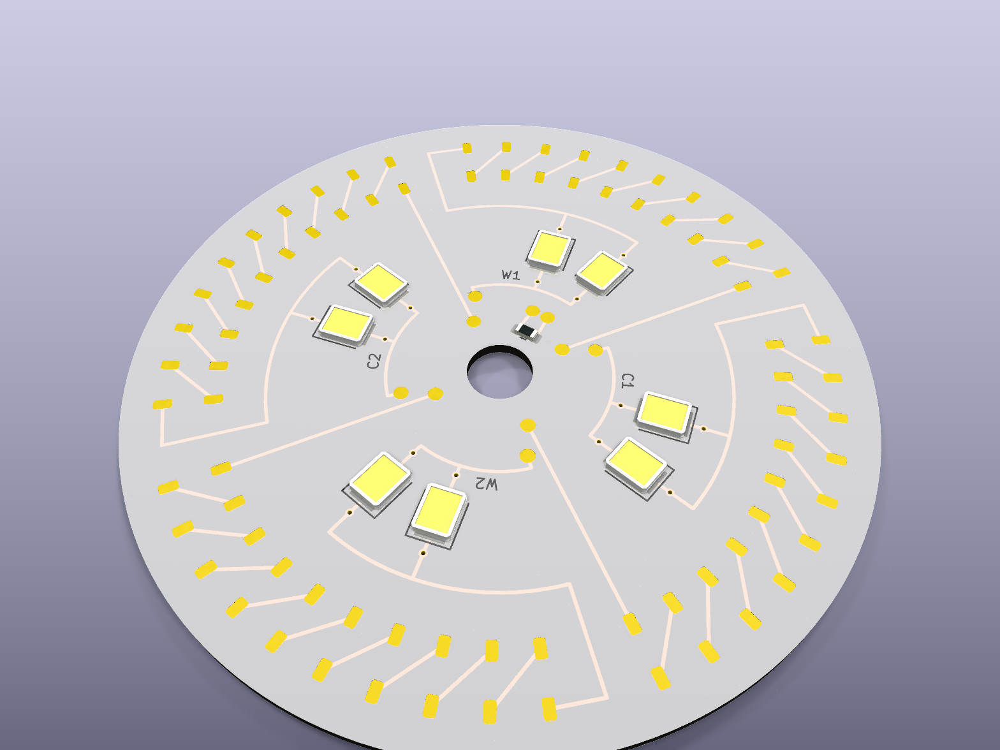
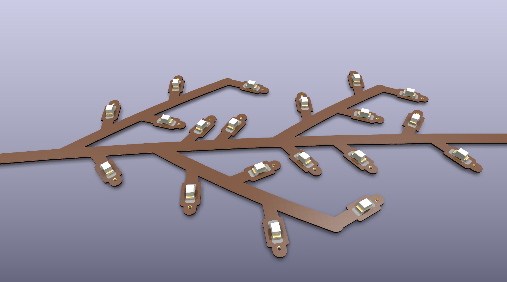

# ECLIPSE Tree: a cedar elm made of light



ECLIPSE Tree is a desk lamp in the form of an old cedar elm (*Ulmus crassifolia*), and every
part of it carries light:

* **Trunk.** A thick (44 mm) trunk and its buttress roots are cast as a thin bronze shell
  around a light-diffusing acrylic light-guide core. Light travels down that core and leaks
  out wherever the bark is split, so the trunk glows through its fissures and the burl's knot
  holes.
* **Crown.** The burl forks into four limbs, then 73 branches, then **1,222 fine spur
  twigs**, 5× the previous crown.
* **Leaves.** At the tips of 40 twigs, flexible-circuit sprays carry **800 LED leaves** (0402).
* **Seeds.** At the tips of 657 other twigs, end-glow optical fibres light **657 diffusing
  samaras** (cedar-elm seeds).

Warm and cool light is interleaved everywhere, so the whole tree can be mixed from candle
glow to daylight, dimmed to embers, or left with only its roots glowing.

| | |
|---|---|
|  |  |
|  |  |
|  |  |
|  |  |

## Four light paths, one driver per colour channel

```
                     ┌─ 2 top LEDs ──► fibre ferrule ──► 4 bundles × ~164 end-glow fibres ──► 657 glowing samaras
 HUB light engine  ──┤
 (in the burl)       └─ 2 bottom LEDs ─► trunk PMMA light-guide core ──► TIR + extraction ──► glowing bark fissures
        │                                                                                    roots, knot holes
        └─ then 10 LED sprigs in series ──► 20 × 0402 leaves each ──► 800 sparkling leaves

 CORE board (base): USB-C PD 9 V → 4 × TPS61165 constant-current boost @ 100 mA (W1 C1 W2 C2)
                    ATtiny1616 touch wheel, colour mix, + 8 LEDs → opal root-glow band (night light)
```

Each colour channel is **one series string of 11 elements** (≈31.5 V, inside the 38 V OVP):
first the hub's 4-LED light-engine group, then 10 sprigs. So all four optical systems dim
and colour-shift together from the same four drivers. The core board circuit is unchanged
from the previous revision, and only 10 wires run down the trunk.

## Key specs

| | |
|---|---|
| Size | ≈377 mm tall, crown ≈340 × 320 mm, on a Ø150 mm base |
| Tree | 44 → 34 mm trunk (cast bronze shell + PMMA core), Ø68 burl, 6 buttress roots, 4 limbs, 73 branches, 1,222 spur twigs (procedural, seeded, reproducible) |
| Light sources | 800 × 0402 LED leaves + 16 × 2835 light-engine LEDs (8 → fibres, 8 → trunk core) + 8 × 2835 root glow |
| Optics | PMMA light-guide trunk with fissure extraction · 657 × 0.5 mm end-glow PMMA fibres in 4 bundles · 657 diffusing-epoxy samaras · opal root band |
| Light | 12.6 W max LED power (firmware cap ≈8.5 W), ≈600 lm total (estimated), 2700-6500 K, flicker-free |
| Mass / stability | ≈2.4 kg, centre of gravity 12 mm from the base centre (63 mm inside the base edge) |
| Power / controls | USB-C PD 9 V (18 W+ charger), capacitive wheel through 3 mm glass |

## What's in this folder

```
eclipse-lamp/
├── mechanical/   tree_gen.py (procedural cedar elm: trunk, roots, limbs, spurs, sprigs, samaras),
│                 eclipse_cad.py (CadQuery), wiring_map.py, out/ (STEP/STL, big STEPs zipped, parts.json)
├── electronics/
│   ├── core/     KiCad 9: base board (power, 4 drivers, touch MCU, root glow), unchanged circuit
│   ├── hub/      KiCad 9: Ø56 two-sided light engine in the burl (16 LEDs) + 40 sprig lands + chaining + NTC
│   ├── sprig/    KiCad 9: polyimide flex cedar-elm spray, 20 × 0402 LED leaves (×40 per lamp)
│   ├── lib/      custom footprints + 3D models
│   └── tools/    generators: schematics (wire router), PCBs, layouts, netlist checks, fab export
├── bom/          eclipse_bom.csv, BOM.md (≈$123 material at 1k units, estimates)
├── renders/      Cycles renders + KiCad board renders, render_blender.py
└── docs/         DESIGN.md (design notes, optics, calculations), WIRING.md (sprig map)
```

## Verification

Every schematic draws every signal connection as a visible wire. There are no net labels,
and power uses power symbols only (see `/CLAUDE.md`).

| Check | Core | Hub | Sprig |
|---|---|---|---|
| ERC | 0 / 0 | 0 / 0 | 0 / 0 |
| DRC | 0 violations | 0 violations | 0 violations |
| Unrouted | 0 | 0 | 0 |
| Schematic ↔ PCB parity | 0 issues | 0 issues | 0 issues |
| Netlist vs design intent | 0 mismatches | 0 mismatches | 0 mismatches |

## Rebuild everything

Requires KiCad 9 (`kicad-cli` + `pcbnew` Python), CadQuery 2.x, shapely, Freerouting 1.9
(core board only, Java 21 + `xvfb-run`) and the `bpy` 5.x module for renders.

```sh
cd electronics/tools
python3 make_footprints.py && python3 make_3d_models.py
for b in core hub sprig; do
  python3 design_$b.py ../$b/eclipse-$b.kicad_sch
  (cd ../$b && kicad-cli sch export netlist --format kicadsexpr -o eclipse-$b.net eclipse-$b.kicad_sch)
  python3 verify_netlist.py design_$b ../$b/eclipse-$b.net
done
python3 pcb_hub.py && python3 pcb_sprig.py   # parametric layouts
./route_core.sh                             # core: placement → Freerouting → pours → DRC
./export_fab.sh                             # gerbers, drill, P&P, PDFs, STEP/GLB, reports
cd ../../mechanical && python3 eclipse_cad.py && python3 wiring_map.py
cd ../bom && python3 make_bom.py
cd ../renders && python3 render_blender.py hero   # hero | trunk | leaves | night | studio | cool | detail
```

See [docs/DESIGN.md](docs/DESIGN.md) for the optics, the calculations and the open items.
